# CRUD de Estudiante con patrones de diseño

CRUD de **Estudiante** en Java (ID, nombre, apellido y dirección) con arquitectura **MVC**, ventana Swing y consola, que guarda los datos en `datos/estudiantes.txt`. Aplica cuatro patrones de diseño: **Iterator**, **Mediator**, **State** y **Template Method**.

## Propósito

Practicar la separación en capas (modelo, vista y controlador) y aplicar cuatro patrones de diseño sobre un mismo CRUD, documentando el diseño con diagramas UML hechos en PlantUML y comprobando el funcionamiento con evidencia de ejecución.

## Productos verificables

| Producto | Dónde está |
|---|---|
| Código fuente en Java | `src/` |
| Datos de prueba | `datos/estudiantes.txt` |
| Diagramas UML (código `.puml` e imagen) | `docs/diagramas/` |
| Capturas de la ventana | `docs/capturas/` |
| Matriz de trazabilidad | Sección "Matriz de trazabilidad" |
| Criterios de aceptación | Sección "Criterios de aceptación" |
| Evidencia de consola | Sección "Evidencia de ejecución por consola" |

## Estructura del proyecto

```text
CRUDestudiante/
├── datos/
│   └── estudiantes.txt
├── docs/
│   ├── capturas/
│   └── diagramas/
├── src/
│   ├── Main.java
│   ├── controlador/
│   │   └── EstudianteController.java
│   ├── modelo/
│   │   ├── Estudiante.java
│   │   ├── EstudianteRepositorio.java
│   │   └── iterador/
│   │       ├── ColeccionEstudiantes.java
│   │       ├── IteradorEstudiante.java
│   │       ├── IteradorPlantilla.java
│   │       └── IteradorSecuencial.java
│   └── vista/
│       ├── ConsolaView.java
│       ├── WindowsView.java
│       ├── estado/
│       │   ├── EstadoFormulario.java
│       │   ├── ModoNuevo.java
│       │   └── ModoEdicion.java
│       └── mediador/
│           ├── Mediador.java
│           ├── MediadorPlantilla.java
│           └── MediadorVentana.java
├── ejecutar.bat
└── README.md
```

## Responsabilidad por capa

| Capa | Clases | Responsabilidad |
|---|---|---|
| Modelo | `Estudiante`, `EstudianteRepositorio` | Guardar y leer los estudiantes en `datos/estudiantes.txt` y validar el formato del ID. |
| Controlador | `EstudianteController` | Recibir los pedidos de las vistas, validar los datos y llamar al repositorio. |
| Vista | `ConsolaView`, `WindowsView` | Mostrar la información y recibir las acciones del usuario (consola o ventana). |
| Arranque | `Main` | Abrir la ventana por defecto o la consola con `--console`. |

## Patrones de diseño aplicados

| Patrón | Problema que resuelve | Clases | Método clave |
|---|---|---|---|
| **Iterator** | Recorrer los estudiantes sin depender de cómo está guardada la lista. | `ColeccionEstudiantes`, `IteradorEstudiante`, `IteradorSecuencial` | `siguiente()` |
| **Mediator** | Coordinar los componentes de la ventana desde un solo punto. | `Mediador`, `MediadorVentana` | `notificar(evento)` |
| **State** | Que el formulario se comporte distinto en modo nuevo y en modo edición. | `EstadoFormulario`, `ModoNuevo`, `ModoEdicion` | `entrar(mediador)` |
| **Template Method** | Fijar el orden de los pasos y dejar que cada clase complete lo que cambia. | `IteradorPlantilla`, `MediadorPlantilla`, `EstadoFormulario` | `siguiente()`, `notificar()`, `entrar()` (todos `final`) |

## Requisitos funcionales

| Código | Requisito |
|---|---|
| RF-01 | Registrar un estudiante. |
| RF-02 | Consultar todos los estudiantes o uno por ID. |
| RF-03 | Modificar nombre, apellido y dirección de un estudiante. |
| RF-04 | Eliminar un estudiante. |
| RF-05 | Validar el formato del ID (`L00` más 6 números) y que los campos no estén vacíos. |
| RF-06 | No permitir IDs repetidos. |
| RF-07 | Guardar los datos en `datos/estudiantes.txt`. |

## Matriz de trazabilidad

| Requisito | Caso de uso | Vista | Controlador | Modelo | Evidencia |
|---|---|---|---|---|---|
| RF-01 | Registrar estudiante | `registrar()` en `ConsolaView` y `WindowsView` | `registrar(...)` | `EstudianteRepositorio.registrar` | Consola, opción 1 |
| RF-02 | Consultar estudiantes | `consultar()` y tabla de `WindowsView` | `consultarTodos()`, `consultarPorId(id)` | `obtenerTodos()`, `obtenerPorId(id)` | Consola, opción 2 |
| RF-03 | Modificar estudiante | `modificar()` | `modificar(...)` | `actualizar(estudiante)` | Consola, opción 3 |
| RF-04 | Eliminar estudiante | `eliminar()` | `eliminar(id)` | `eliminar(id)` | Consola, opción 4 |
| RF-05 | Validar datos | Muestra el mensaje de error | `validar(...)` | `Estudiante.esIdValido(id)` | Error de formato de ID |
| RF-06 | Registrar estudiante | Muestra el mensaje de error | (propaga el error) | `registrar` revisa el ID repetido | Error de ID repetido |
| RF-07 | Todos | (no interviene) | (no interviene) | `guardar(...)`, `obtenerTodos()` | `datos/estudiantes.txt` |

## Criterios de aceptación

| Código | Criterio | Resultado |
|---|---|---|
| RF-01 | Con ID válido y campos llenos se guarda el estudiante y se muestra "Estudiante registrado." | Cumple |
| RF-02 | La opción 2 con `0` lista todos; con un ID muestra solo ese estudiante. | Cumple |
| RF-03 | Con un ID existente actualiza los datos y muestra "Estudiante modificado." | Cumple |
| RF-04 | Con un ID existente elimina al estudiante y muestra "Estudiante eliminado." | Cumple |
| RF-05 | Rechaza IDs con formato incorrecto y campos vacíos con un mensaje de error. | Cumple |
| RF-06 | Al registrar un ID existente muestra "Ya existe un estudiante con ese ID." | Cumple |
| RF-07 | Los estudiantes siguen en `datos/estudiantes.txt` al reabrir el programa. | Cumple |
| Patrones | `siguiente()`, `notificar()` y `entrar()` son `final`; en edición el campo ID queda bloqueado. | Cumple |

## Diagramas UML (PlantUML)

Los diagramas están escritos en PlantUML. Cada archivo `.puml` está en `docs/diagramas/` junto con su imagen `.png`.

### Diagrama de casos de uso

Qué puede hacer el usuario con el sistema.


<details>
<summary>Ver código PlantUML (<code>docs/diagramas/m01_casos_uso.puml</code>)</summary>

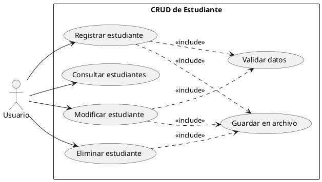

</details>

### Diagrama de paquetes

Los paquetes de MVC y sus dependencias.


<details>
<summary>Ver código PlantUML (<code>docs/diagramas/m02_paquetes.puml</code>)</summary>

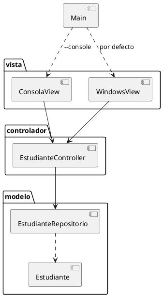

</details>

### Diagrama de clases (MVC)

Clases del proyecto base con atributos, métodos y relaciones.


<details>
<summary>Ver código PlantUML (<code>docs/diagramas/m03_clases.puml</code>)</summary>

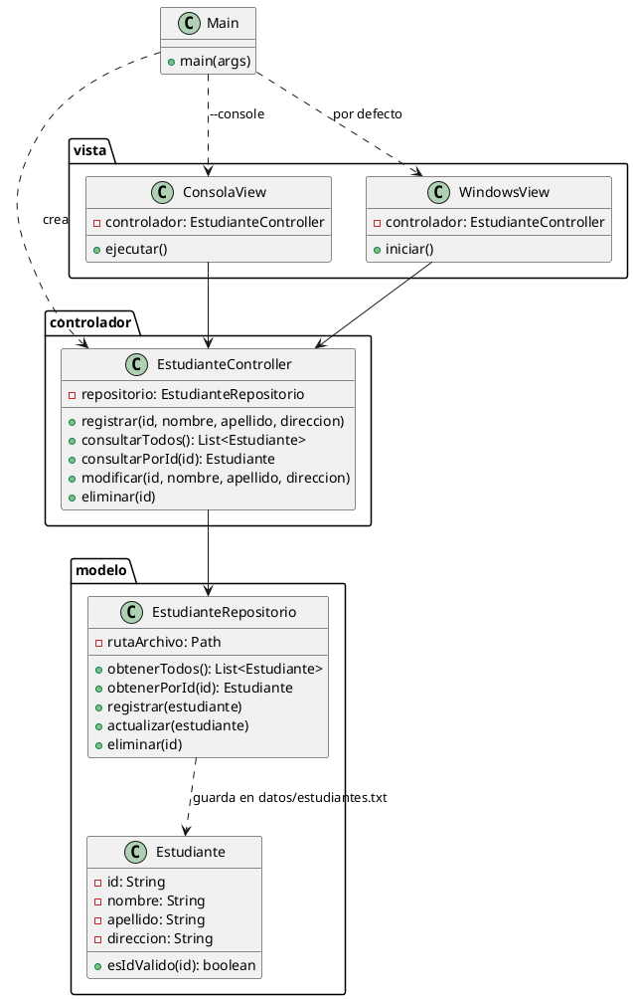

</details>

### Diagrama de secuencia: registrar

Mensajes entre la ventana, el controlador, el repositorio y el archivo al registrar.


<details>
<summary>Ver código PlantUML (<code>docs/diagramas/m04_secuencia_registrar.puml</code>)</summary>

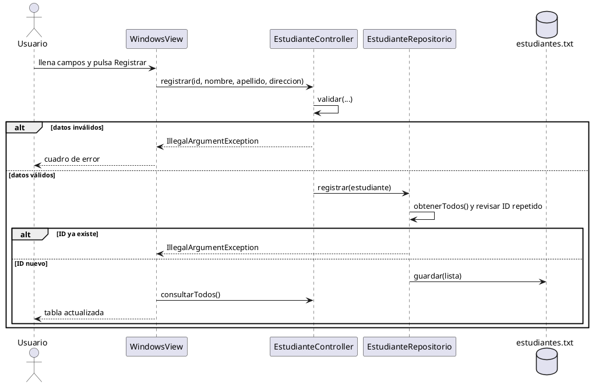

</details>

### Diagrama de secuencia: eliminar

Mensajes al eliminar, con la confirmación de la ventana.


<details>
<summary>Ver código PlantUML (<code>docs/diagramas/m05_secuencia_eliminar.puml</code>)</summary>

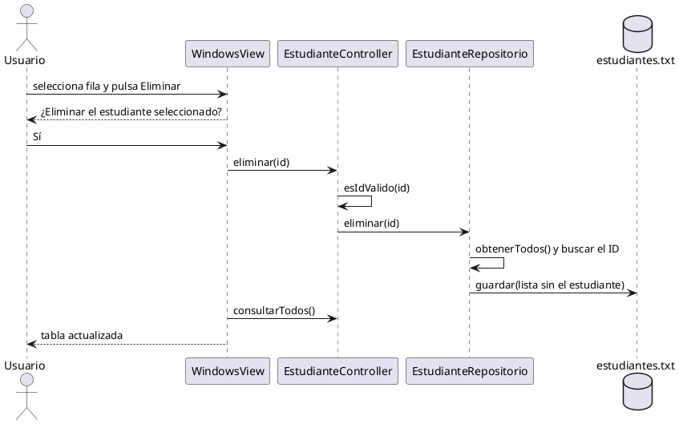

</details>

### Diagrama de actividades: registrar

Validación del formato y revisión del ID repetido.


<details>
<summary>Ver código PlantUML (<code>docs/diagramas/m06_actividad_registrar.puml</code>)</summary>

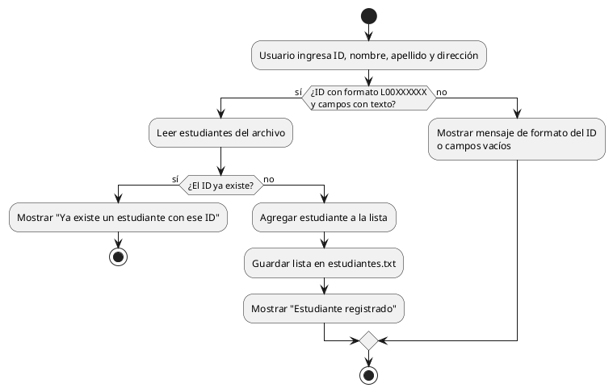

</details>

### Diagrama de componentes

Componentes del sistema y sus conexiones.


<details>
<summary>Ver código PlantUML (<code>docs/diagramas/m07_componentes.puml</code>)</summary>

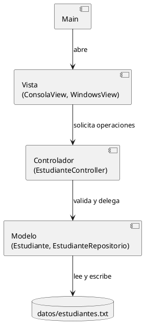

</details>

### Diagrama de despliegue

Dónde se ejecuta el programa y dónde se guardan los datos.


<details>
<summary>Ver código PlantUML (<code>docs/diagramas/m08_despliegue.puml</code>)</summary>

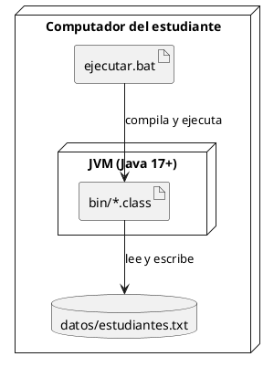

</details>

### Diagramas de los patrones

Los diagramas de Iterator, Mediator y State corresponden a las versiones individuales de cada patrón (clases `IteradorEstudiantes`, `EstudianteMediator`, `EstadoNuevo` y `EstadoEdicion`). El diagrama de Template Method corresponde al proyecto con los cuatro patrones.

### Iterator: diagrama de clases


<details>
<summary>Ver código PlantUML (<code>docs/diagramas/p01_iterator_clases.puml</code>)</summary>

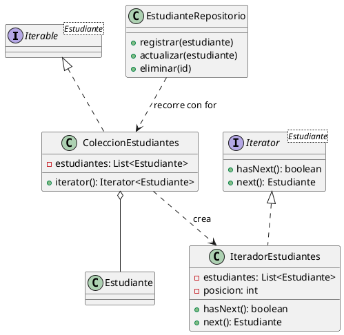

</details>

### Iterator: diagrama de secuencia


<details>
<summary>Ver código PlantUML (<code>docs/diagramas/p02_iterator_secuencia.puml</code>)</summary>

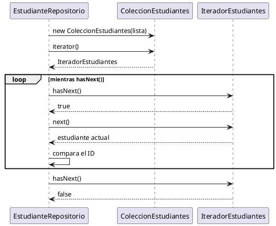

</details>

### Mediator: diagrama de clases


<details>
<summary>Ver código PlantUML (<code>docs/diagramas/p03_mediator_clases.puml</code>)</summary>

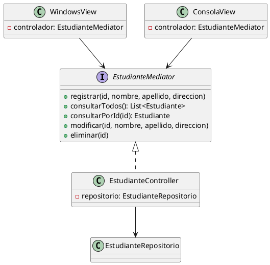

</details>

### Mediator: diagrama de secuencia


<details>
<summary>Ver código PlantUML (<code>docs/diagramas/p04_mediator_secuencia.puml</code>)</summary>

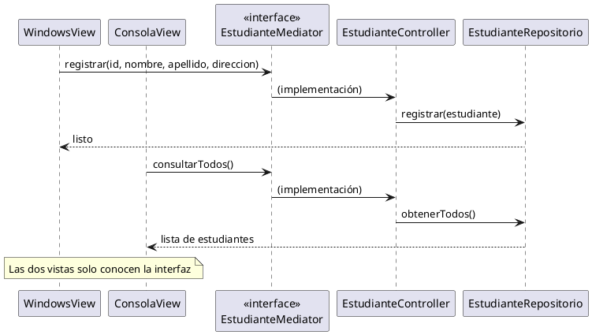

</details>

### State: diagrama de clases


<details>
<summary>Ver código PlantUML (<code>docs/diagramas/p05_state_clases.puml</code>)</summary>

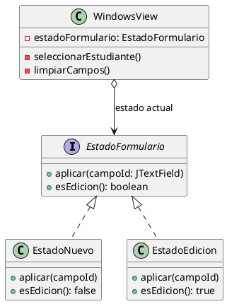

</details>

### State: diagrama de estados


<details>
<summary>Ver código PlantUML (<code>docs/diagramas/p06_state_estados.puml</code>)</summary>

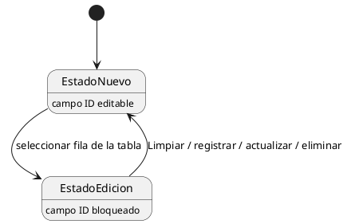

</details>

### Template Method: diagrama de clases


<details>
<summary>Ver código PlantUML (<code>docs/diagramas/p07_template_clases.puml</code>)</summary>

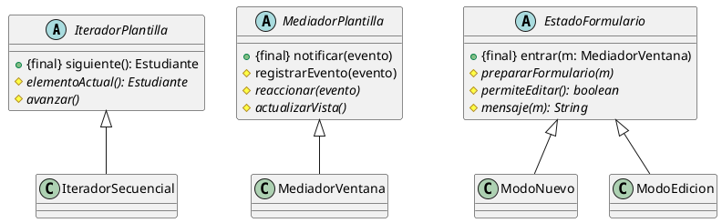

</details>

### Template Method: diagrama de actividades


<details>
<summary>Ver código PlantUML (<code>docs/diagramas/p08_template_actividad.puml</code>)</summary>

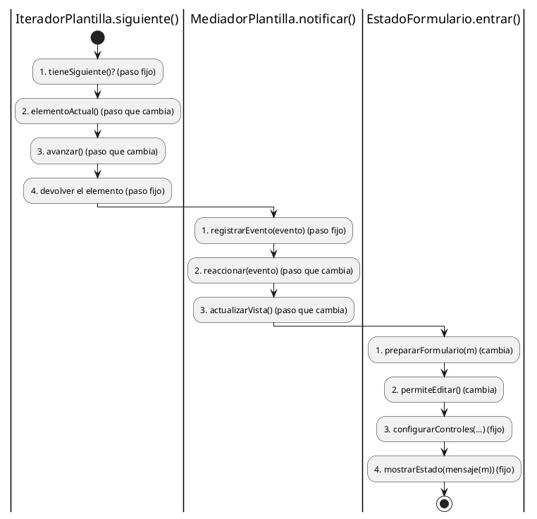

</details>

### Template Method: diagrama de secuencia


<details>
<summary>Ver código PlantUML (<code>docs/diagramas/p09_template_secuencia.puml</code>)</summary>

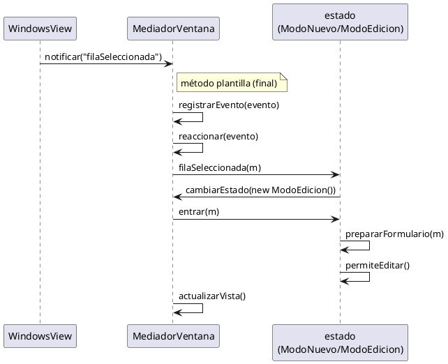

</details>

## Capturas del programa

| Versión | Captura |
|---|---|
| Iterator |  |
| Mediator |  |
| State (modo nuevo) |  |
| State (modo edición) |  |
| Cuatro patrones |  |

## Evidencia de ejecución por consola

Prueba con dos registros, un ID repetido, un ID con formato incorrecto, consulta de todos, consulta por ID, modificación y eliminación:

```text
=== CRUD de estudiantes ===
1. Registrar estudiante
2. Consultar estudiantes
3. Modificar estudiante
4. Eliminar estudiante
0. Salir
Opcion: 1
ID (L00XXXXXX): L00123456
Nombre: Ana
Apellido: Torres
Direccion: Calle 10
Estudiante registrado.

Opcion: 1
ID (L00XXXXXX): L00654321
Nombre: Luis
Apellido: Perez
Direccion: Av. Quito
Estudiante registrado.

Opcion: 1
ID (L00XXXXXX): L00123456
Nombre: Repetido
Apellido: Prueba
Direccion: Centro
Error: Ya existe un estudiante con ese ID.

Opcion: 1
ID (L00XXXXXX): L00-12
Nombre: X
Apellido: Y
Direccion: Z
Error: El ID debe tener el formato L00 seguido de 6 numeros (ej: L00123456) y los campos no pueden quedar vacios.

Opcion: 2
ID (L00XXXXXX, o 0 para consultar todos): 0

ID: L00123456
Nombre: Ana
Apellido: Torres
Direccion: Calle 10

ID: L00654321
Nombre: Luis
Apellido: Perez
Direccion: Av. Quito

Opcion: 2
ID (L00XXXXXX, o 0 para consultar todos): L00123456

ID: L00123456
Nombre: Ana
Apellido: Torres
Direccion: Calle 10

Opcion: 3
ID (L00XXXXXX): L00123456
Nuevo nombre: Ana Maria
Nuevo apellido: Ruiz
Nueva direccion: Carrera 7
Estudiante modificado.

Opcion: 4
ID (L00XXXXXX): L00654321
Estudiante eliminado.

Opcion: 2
ID (L00XXXXXX, o 0 para consultar todos): 0

ID: L00123456
Nombre: Ana Maria
Apellido: Ruiz
Direccion: Carrera 7

Opcion: 0
Hasta luego.
```

## Cómo ejecutar

Requisitos: JDK 17 o superior con `javac` en el PATH.

```bash
# Ventana (por defecto)
ejecutar.bat

# Consola
ejecutar.bat --console
```

También se puede compilar a mano:

```bash
mkdir bin
javac -encoding UTF-8 -d bin -sourcepath src src/Main.java
java -cp bin Main            # ventana
java -cp bin Main --console  # consola
```

Los datos se guardan en `datos/estudiantes.txt`.

## Notas

- Las versiones individuales de Iterator, Mediator y State validan el ID con el formato `L00-0000`; esta versión con los cuatro patrones usa `L00` más 6 números (por ejemplo `L00007867`).

## Integrantes

- Rubén Bustos
- Estefany Pincha
- Mateo Venegas
